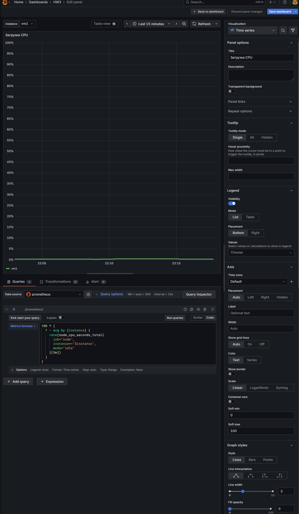
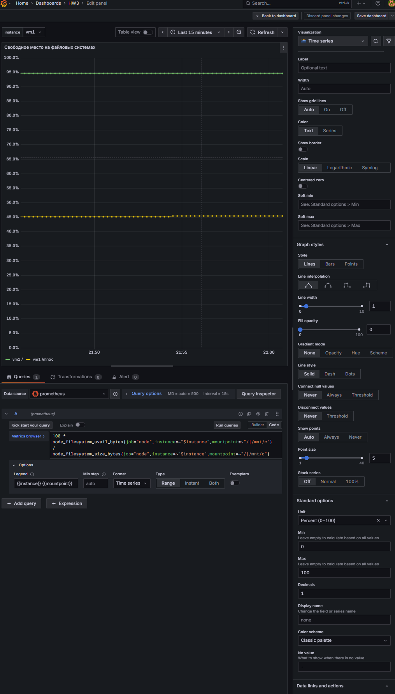
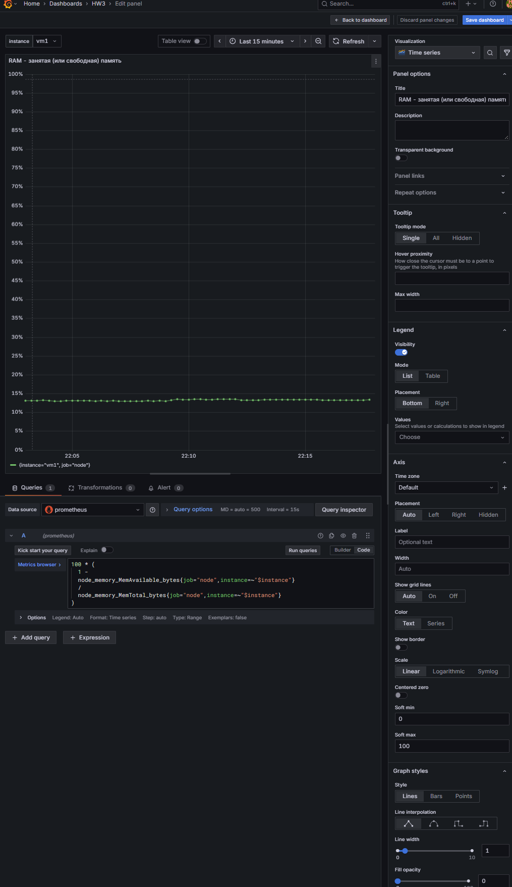
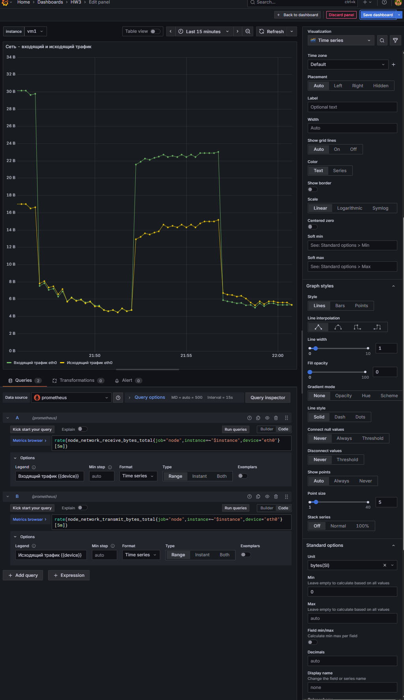
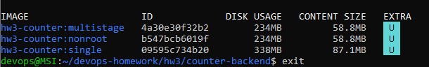

Исходный файл с логами переносить в md не стал (криво отображается часть символов, решил оставить в исходном формате)

- [Логи - terminal.log](terminal.log)

Скрины с первой части ДЗ:

- Targets

- Save & Test

- Dashboard

- Переменные дашборда в побробностях:
   

Подробности в логах, но итог:
Сравнение размеров образов
